# WealthTrack Backend Architecture

Maintained in this independent Git repository at **docs/architecture.md**. Updated **2026-11-09**. The guide covers the implemented stack, interfaces, data model, operational limits, and release requirements.

## Contents

1. [Scope, users, and repository boundary](#1-scope-users-and-repository-boundary)
2. [Context, containers, and trust boundaries](#2-context-containers-and-trust-boundaries)
3. [Source ownership and module map](#3-source-ownership-and-module-map)
4. [Screens, navigation, and lifecycle](#4-screens-navigation-and-lifecycle)
5. [Primary workflows and recovery](#5-primary-workflows-and-recovery)
6. [Domain, persistence, and data ownership](#6-domain-persistence-and-data-ownership)
7. [API and internal contracts](#7-api-and-internal-contracts)
8. [Security, privacy, and egress](#8-security-privacy-and-egress)
9. [Design, accessibility, and platform adapters](#9-design-accessibility-and-platform-adapters)
10. [Build, checks, and deployment](#10-build-checks-and-deployment)
11. [Architecture decisions and tradeoffs](#11-architecture-decisions-and-tradeoffs)
12. [Requirements traceability](#12-requirements-traceability)
13. [Dated verification and limitations](#13-dated-verification-and-limitations)
14. [Extension rules and companion repository](#14-extension-rules-and-companion-repository)

## 1. Scope, users, and repository boundary

Personal-finance exploration with synthetic household records.

Transactions, categories, budgets, goals, cash flow, recurring bills, and validated CSV import with preview.

This repository owns the Node.js ESM API and SQLite state. UI rendering belongs to the separate frontend. The service validates and executes the domain operations described below.

There are two independent Git roots for this application, each with its own README and architecture guide. A parent app/workspace folder is a checkout convenience. Use synthetic records; current local services remain on loopback.

The current implementation boundary is defined by the source map and contracts in this guide.

## 2. Context, containers, and trust boundaries

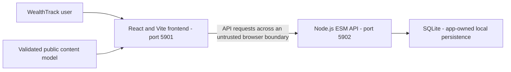

The API is the data authority, but only the identity/ownership controls actually implemented below can be relied on. CORS is not authentication.

### C4 system context

The only current actor is a local synthetic-data planner. The profile name and role shown by the UI are presentation copy, not an authenticated identity.

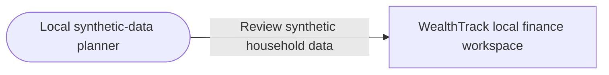

No bank, payment, or identity provider is connected.

### C4 container view

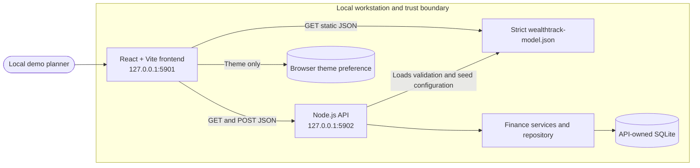

The frontend and API are separate runnable applications. The browser validates the public model and API responses with Zod. The API validates requests again, owns all database writes, and uses parameterized SQLite statements. CORS permits the configured local UI origins; it is not authorization.

## 3. Source ownership and module map

| Owner/path                                                                                                                             | Responsibility                                                               |
| -------------------------------------------------------------------------------------------------------------------------------------- | ---------------------------------------------------------------------------- |
| [src/main.mjs](../src/main.mjs) [src/server.mjs](../src/server.mjs)                                                                 | Process bootstrap, HTTP composition, and configuration                       |
| [src/http/api-router.mjs](../src/http/api-router.mjs)                                                                                  | HTTP route and request-adapter owners                                        |
| [src/import.service.mjs](../src/import.service.mjs)                                                                                    | Application workflow/state-machine owners                                    |
| [src/finance.repository.mjs](../src/finance.repository.mjs)                                                                            | Storage/transaction owners; memory where implemented                         |
| [src/model.schema.mjs](../src/model.schema.mjs) [src/schema.sql](../src/schema.sql)                                                 | Validation/schema and migration authority                                    |
| [src/services/rate-limiter.mjs](../src/services/rate-limiter.mjs)                                                                      | Existing session/role/limiter modules; their presence is not a hosting claim |
| [src/observability/logging.mjs](../src/observability/logging.mjs)                                                                      | Safe errors, origin handling, or request correlation as implemented          |
| [openapi.yaml](../openapi.yaml)                                                                                                        | Published request/response contract source                                   |
| [.github/workflows](../.github/workflows)                                                                                              | Configured CI; hosted outcomes require separate verification                 |
| [src/finance.repository.test.mjs](../src/finance.repository.test.mjs) [src/import.service.test.mjs](../src/import.service.test.mjs) | Examples of existing colocated tests                                         |

The source map follows the existing framework directories and test placement.

## 4. Screens, navigation, and lifecycle

This repository has no rendered screens. It supports the frontend through the HTTP/domain contracts in sections 5–7. Its lifecycle entry, response/error mapping, session behavior where present, and storage ownership are listed in section 3. Startup health is http://127.0.0.1:5902/api/v1/health; that configured address is not evidence of a running service. Persistent state is owned by this backend; preserve existing database files during changes.

## 5. Primary workflows and recovery

### Primary user flows

The role in every current flow is the unauthenticated local synthetic-data planner. Preconditions and recovery paths are listed per scenario. No flow implies bank connectivity or financial advice.

#### 1. Open the workspace

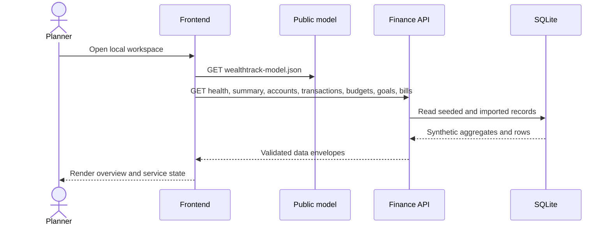

**Precondition:** both loopback services are running. **Success:** model and summary load. **Failure/recovery:** model failure shows the boot error; API failure shows a retry action. **Authorization/telemetry:** no identity check exists; request IDs and route/status/duration are logged without payloads.

#### 2. Review cash flow

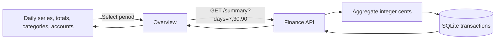

**Precondition:** overview data is available. **Success:** period totals and daily series render. **Failure/recovery:** an API error is surfaced and refresh/retry re-requests data. Periods are server-validated; requests are logged with a route template and duration.

#### 3. Search and filter transactions

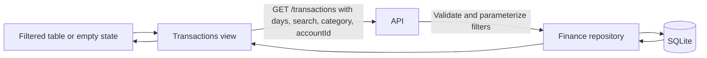

**Precondition:** accounts and transaction data are loaded. **Success:** filters update the table. **Failure/recovery:** invalid category/account is rejected by the API; clear or change filters and retry. There is no per-user ownership scope yet.

#### 4. Download the CSV template

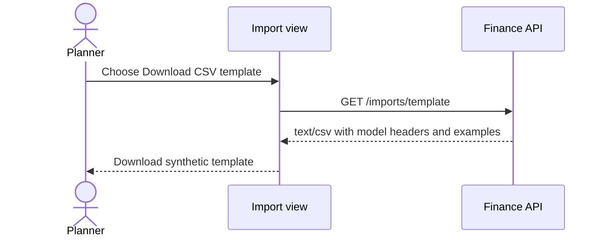

**Precondition:** API is reachable. **Success:** a template with the configured header and two synthetic examples downloads. **Failure/recovery:** the UI reports the request error; retry after restoring the service. No personal data is included in the template.

#### 5. Preview a CSV

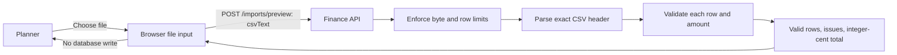

**Precondition:** a CSV uses the published template. **Success:** validated and invalid row counts, issues, and total are shown before saving. **Failure/recovery:** correct the row/header or choose another file; preview never commits partial rows. Logs contain only route/status metadata.

#### 6. Commit a valid import

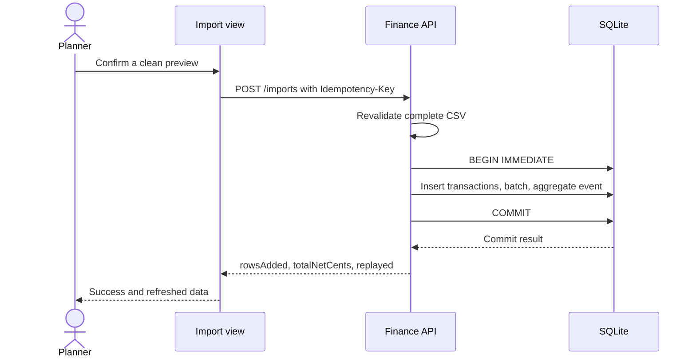

**Precondition:** preview has no invalid rows and at least one valid row. **Success:** all records and the batch commit atomically. **Failure/recovery:** invalid data is rejected without writes; retrying the same key is idempotent. No user/tenant key is accepted because authentication is not implemented.

#### 7. Review budgets

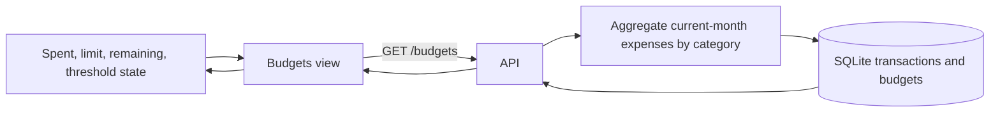

**Precondition:** API is available. **Success:** current-month spending is compared with configured category limits. **Failure/recovery:** retry the read; budgets are read-only in this prototype. Aggregates use integer cents.

#### 8. Track savings goals

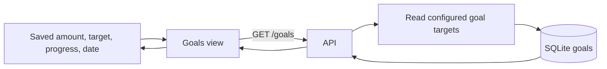

**Precondition:** seeded goals are present. **Success:** progress and target dates render. **Failure/recovery:** refresh after API recovery. Goal editing and identity-scoped access are not implemented.

#### 9. Review recurring commitments

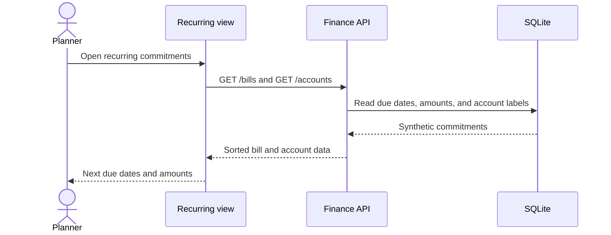

**Precondition:** API is available. **Success:** synthetic bills are shown in due-date order with account labels. **Failure/recovery:** retry the read; no payment is scheduled or initiated.

#### 10. Recover from invalid import or API failure

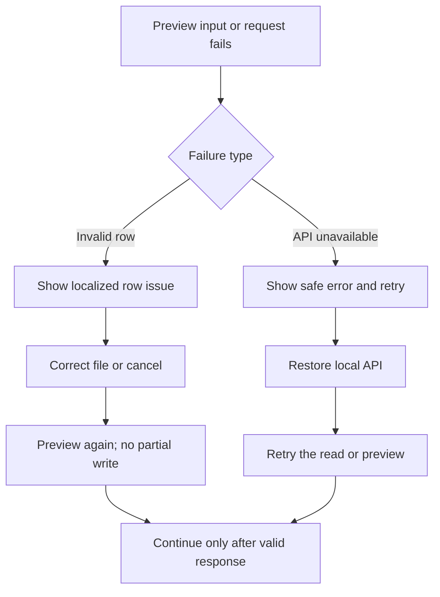

**Precondition:** malformed CSV or an unavailable API. **Success:** corrected data is revalidated or the API request succeeds. **Failure/recovery:** the original transaction count remains unchanged after invalid import; a failed fetch retains a retry action. The service logs safe error codes and request IDs, not CSV rows.

## 6. Domain, persistence, and data ownership

The API owns the current persistence boundary. Keep database engines, schema/migration order, exact-money rules where applicable, and transaction invariants consistent with executable source.

### Data ownership

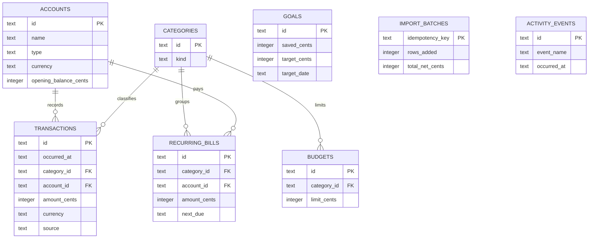

The API creates and owns `wealthtrack-backend/data/wealthtrack.sqlite` by default. `WEALTHTRACK_DB_PATH` can override the file path. Tests use an in-memory SQLite database. Seed records and all money values are synthetic and represented as integer cents with an explicit currency. CSV parsing uses exact decimal text-to-cents conversion; imports are rejected if the existing ledger plus incoming rows could exceed the safe-integer aggregate range. Display formatting never feeds calculations.

## 7. API and internal contracts

The repository contract is [openapi.yaml](../openapi.yaml). Keep public paths, status/error envelopes, headers, payload validation, and compatibility tied to that source.

### API and import contract

The versioned API is described in [OpenAPI](../openapi.yaml). It exposes `GET /health`, `/accounts`, `/summary`, `/transactions`, `/budgets`, `/goals`, and `/bills`, plus `GET /imports/template`, `POST /imports/preview`, and `POST /imports`. Successful JSON responses use a `{ "data": ... }` envelope. Errors use `{ "error": { "code", "message", "requestId", "details?" } }`.

The API validates configured origins, request size, reporting periods, transaction filters, CSV header order, row count, date, amount precision/sign, currency, category, and account. Preview performs no writes. Commit requires an `Idempotency-Key`; SQLite inserts validated rows, the import batch, and a safe aggregate event in one transaction. Replays return the original batch without duplicate rows. Requests emit structured completion logs with request/trace IDs, route template, method, status, duration, and safe error code; payloads and transaction details are not logged. `WEALTHTRACK_ALLOWED_ORIGINS` accepts a comma-separated list of explicit URL origins for isolated test environments; the content-model list is the default.

The frontend also exports up to 500 transactions through the bounded API query. It quotes and escapes every CSV cell, prefixes formula-like text with an apostrophe, and formats signed amount values from integer cents without changing their precision or sign. This local export has no user ownership scope because authentication is not implemented.

### API and Authorization Matrix

The only current actor is an unauthenticated local household planner. The
configured `Origin` allowlist controls browser origins, but CORS is not
authentication. Every local caller can access the same synthetic household
dataset. There are no users, owner IDs, roles, or catalog-editor routes.

| Route                                                                        | Authorization                                                                                | Data ownership/change                                                                                           | Expected failure                                                                                                              |
| ---------------------------------------------------------------------------- | -------------------------------------------------------------------------------------------- | --------------------------------------------------------------------------------------------------------------- | ----------------------------------------------------------------------------------------------------------------------------- |
| `GET /health`                                                                | No identity; loopback-only process.                                                          | Readiness only; no domain write.                                                                                | Safe internal error if SQLite is unavailable.                                                                                 |
| `GET /accounts`, `/summary`, `/transactions`, `/budgets`, `/goals`, `/bills` | No identity or household filter. Period/category/account/filter values are server-validated. | Reads API-owned synthetic SQLite data.                                                                          | `INVALID_PERIOD`, `INVALID_FILTER`, `INVALID_CATEGORY`, `ACCOUNT_NOT_FOUND`, `RATE_LIMITED`, or safe `INTERNAL_ERROR`.        |
| `GET /imports/template`                                                      | No identity; local origin allowlist if `Origin` is present.                                  | No database read/write; downloads model-configured synthetic examples.                                          | `ORIGIN_NOT_ALLOWED`, `RATE_LIMITED`, or safe error.                                                                          |
| `POST /imports/preview`                                                      | No identity; bounded strict JSON body and CSV validation.                                    | Reads model/known accounts; never writes.                                                                       | `INVALID_JSON`, `PAYLOAD_TOO_LARGE`, row-level validation issues, or safe API error.                                          |
| `POST /imports`                                                              | No identity; requires syntactically valid `Idempotency-Key` and strict bounded body.         | Validates ownership-independent synthetic rows, then atomically writes rows, import batch, and aggregate event. | `IDEMPOTENCY_KEY_REQUIRED`, `INVALID_CSV`, `RATE_LIMITED`, or safe API error. Same-key retries replay without duplicate rows. |

Unknown routes return `NOT_FOUND`; the API does not expose a caller-supplied
profile or role.

## 8. Security, privacy, and egress

Current release limitation: **No sign-in, household ownership, or bank integration. Use synthetic CSVs only; formatting, bundle, identity, persistence, and import isolation work remain.**

### Authorization, observability, and limitations

There is one local synthetic-data persona and no authenticated principal. The API currently serves the same synthetic household data to every local caller; this is a blocker before any multi-user or external deployment. The API binds to loopback and checks configured browser origins, but CORS does not protect API authorization. Operational logs include request ID, trace ID, route, method, status, duration, and outcome; there is no metrics collector or audit viewer.the relevant configuration or validation section in this guide for threat boundaries and remaining controls.

Keep private credentials out of public models, browser bundles, logs, URLs, and source archives. No additional runtime network destination or external service is configured. Keep logs limited to the source-defined request/trace and safe aggregate fields. Backups, retention, deletion, and real-user ownership need explicit product/operations decisions before external exposure.

## 9. Design, accessibility, and platform adapters

There is no visual rendering or native package in this API repository. Preserve safe errors and stable contracts so the frontend can present accessible recovery states. Hardware scanning, banking/payment rails, shipping providers, and native integrations remain limited to what the current source actually implements; simulator behavior is not device/provider integration.

## 10. Build, checks, and deployment

Configured npm scripts, from this repository with Node **24.15.0**; use `npm.cmd` in PowerShell:

| Command                    | Actual manifest definition                                                                                                                                                                   |
| -------------------------- | -------------------------------------------------------------------------------------------------------------------------------------------------------------------------------------------- |
| `npm.cmd run dev`          | `node --watch src/main.mjs`                                                                                                                                                                  |
| `npm.cmd run start`        | `node src/main.mjs`                                                                                                                                                                          |
| `npm.cmd run test`         | `node --test`                                                                                                                                                                                |
| `npm.cmd run test:cov`     | `c8 --all --include="src/**/*.mjs" --exclude="src/**/*.test.mjs" --exclude="src/main.mjs" --check-coverage --lines 90 --branches 90 --functions 90 --statements 90 --reporter=text npm test` |
| `npm.cmd run check`        | `node --check src/main.mjs && node --check src/server.mjs`                                                                                                                                   |
| `npm.cmd run lint`         | `eslint src`                                                                                                                                                                                 |
| `npm.cmd run format:check` | `prettier --check "src/**/*.mjs" "eslint.config.mjs" ".github/workflows/*.yml" "openapi.yaml"`                                                                                               |

Install with `npm.cmd ci` and retain [package-lock.json](../package-lock.json). Registry access is required for a clean dependency installation. These commands describe the configured checks; execution results are listed in section 13.

The API remains loopback-only. Direct-start storage is `data/wealthtrack.sqlite` relative to this repository. The adjacent `../wealthtrack-frontend/public/wealthtrack-model.json` file is a required seed/content input; process environment variables are read, and a .env file is not loaded automatically.

CI configuration is listed in section 3. Run the configured checks before merging or releasing. Deployment requires separate verification of the selected hosting environment.

## 11. Architecture decisions and tradeoffs

### Implemented Design Patterns and Invariants

- The API is the only SQLite client. HTTP routing, request validation, finance
  services, and the repository are separate modules. The repository owns the
  schema in `wealthtrack-backend/src/schema.sql`, parameterized SQL, and
  transaction boundaries.
- The frontend and backend load the same strict
  `version/appId/locale/messages/data` envelope from
  `wealthtrack-frontend/public/wealthtrack-model.json`; both validate it with
  Zod. Architecture diagrams and planned hosting design exist only in this
  developer document, not in the model or product UI.
- All monetary values in the API, repository, CSV parser/exporter, and UI
  calculations are integer cents paired with an explicit currency. CSV decimal
  text is parsed exactly, not through binary floating-point conversion.
- CSV preview is read-only. Commit revalidates the entire file and atomically
  writes transaction rows, an import batch, and an aggregate activity event.
  `Idempotency-Key` makes a retry of the same committed batch replay-safe.
- New seed rows use `INSERT OR IGNORE`; this does not migrate changed seed data
  into an existing SQLite file. There is no versioned schema migration system.
- The browser persists only the non-sensitive theme preference. No account,
  transaction, CSV, balance, or identity state is kept in localStorage.

The two Git repositories remain separate. Each owns one maintained README and this repository-local architecture guide. Shared application behavior may be described here for contract context, but implementation changes belong to the owning source module.

## 12. Requirements traceability

| Capability                       | Acceptance                                                        | Owner/path                         | Current status                                                | Evidence                               | Risk                                                                                                                                                        |
| -------------------------------- | ----------------------------------------------------------------- | ---------------------------------- | ------------------------------------------------------------- | -------------------------------------- | ----------------------------------------------------------------------------------------------------------------------------------------------------------- |
| Repository-local architecture    | Guide available in this checkout and linked from README           | docs/architecture.md; README.md    | Documented and validated                                      | File, link, and diagram checks         | Keep documentation consistent with source changes                                                                                                           |
| API composition and domain state | Preserve existing workflows and failure states                    | src/server.mjs and source map      | Implemented; application verification limits are listed below | Current source and existing app design | No sign-in, household ownership, or bank integration. Use synthetic CSVs only; formatting, bundle, identity, persistence, and import isolation work remain. |
| Public deployment                | Verified identity, data durability, recovery, and hosted behavior | Existing deployment/API boundaries | Needs separate hardening/verification                         | No new hosted evidence                 | Local checks do not establish production readiness                                                                                                          |

## 13. Dated verification and limitations

Last documentation review: **2026-11-09**. The checks below distinguish documentation validation from application and deployment testing.

- Repository-local guide, README link, source-path references, section/contents anchors, and Mermaid syntax: passed documentation validation.
- New application tests/builds, coverage, dependency audits, browser/device accessibility/performance, hosted CI, and Vercel deployment: **not rerun for the documentation updates**.
- Frontend production builds passed on 2026-11-09 with Node 24.15.0. Build success does not establish that all application quality gates pass.
- Outstanding baseline limit: No sign-in, household ownership, or bank integration. Use synthetic CSVs only; formatting, bundle, identity, persistence, and import isolation work remain.

The baseline results below record earlier validation. Re-run the listed commands against the current revision before release.

Previously recorded application verification:

### Verification and Known Gaps

Start `wealthtrack-backend` with `npm start` and `wealthtrack-frontend` with
`npm run dev` in separate terminals. The API binds to `127.0.0.1:5902`; the UI
binds to `127.0.0.1:5901`. Use only the synthetic model and a local SQLite
database.

Backend checks: `npm run format:check`, `npm run lint`, `npm run check`,
`npm test`, `npm run test:cov`, and `npm audit`. Frontend checks:
`npm run format:check`, `npm run lint`, `npm run typecheck`, `npm run test:unit`,
`npm run test:cov`, `npm audit`, `npm run test:e2e`, and
`VITE_IS_MOCK=false npm run test:e2e`. Unit/API tests use synthetic fixtures
and in-memory SQLite. Playwright builds into ignored
`node_modules/.cache/wealthtrack-e2e`, runs on ports 5903/5904, and uses an
in-memory API database with a test-only request limit. The E2E runner does not
reuse standard services or the default SQLite file.

Coverage gates require >=90% for statements, branches, functions, and lines.
Frontend coverage excludes only `src/main.tsx`, the Vite root mounting
bootstrap. Backend coverage excludes only `src/main.mjs`, the process startup
and signal-handling wrapper. E2E verifies both entrypoints and exercises the
main data workflows.

Known gaps remain identity/household ownership, versioned schema migrations
and seed updates, database encryption at rest, production PostgreSQL,
distributed rate limiting, manual accessibility review, and measured
Core Web Vitals. Do not treat the local prototype or the isolated live-selection
tests as production/financial-institution integration.

### Verification and Known Gaps

Start the backend from `wealthtrack-backend` with `npm start` and the UI from
`wealthtrack-frontend` with `npm run dev`. These standard services bind to
`127.0.0.1:5902` and `127.0.0.1:5901`. Use only synthetic data.

Backend verification: `npm run format:check`, `npm run lint`, `npm run check`,
`npm test`, `npm run test:cov`, and `npm audit`. Frontend verification:
`npm run format:check`, `npm run lint`, `npm run typecheck`, `npm run test:unit`,
`npm run test:cov`, `npm audit`, and both `npm run test:e2e` and
`VITE_IS_MOCK=false npm run test:e2e`. Unit tests use in-memory SQLite. E2E
builds into ignored `node_modules/.cache/wealthtrack-e2e`, runs on ports
5903/5904 with in-memory SQLite and a test-only request limit, and never
reuses the standard services or database. The live-selection E2E target is the
isolated test API, not a financial institution or production database.

Coverage gates require >=90% for statements, branches, functions, and lines.
Frontend coverage excludes only `src/main.tsx`, the Vite root mounting
bootstrap; E2E exercises the application startup. Backend coverage excludes
only `src/main.mjs`, the process startup/signals wrapper; E2E exercises that
entrypoint. Remaining unverified items include hosted PostgreSQL migration,
identity/ownership, formal SAST/secret-history scans, manual WCAG review, and
measured Core Web Vitals/performance budgets.

## 14. Extension rules and companion repository

Start with [README.md](../README.md) and this guide. The companion repository is [wealthtrack-frontend](https://github.com/gopichand-retail-apps/wealthtrack-frontend); clone the pair as siblings when using the existing local integration/model contract. This guide is inside the current repository and does not depend on a parent-folder architecture file to exist.

Update this guide when owned source, routes, persistence, identity, UI states, egress, or deployment behavior changes. Coordinate public contract changes with the companion repository and tests. Preserve existing data, run isolated checks with synthetic records, record failures, and review release and infrastructure changes before publication.
